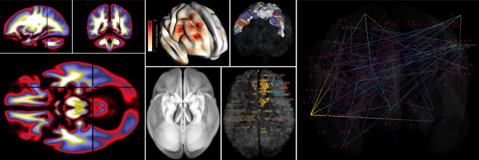
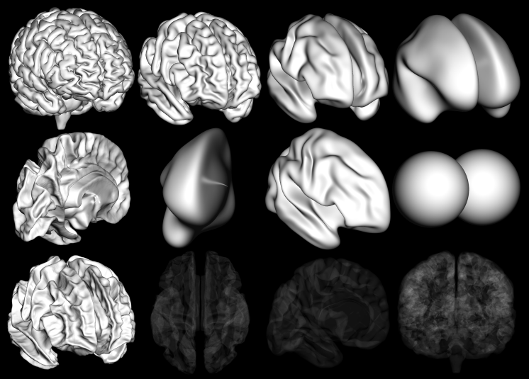
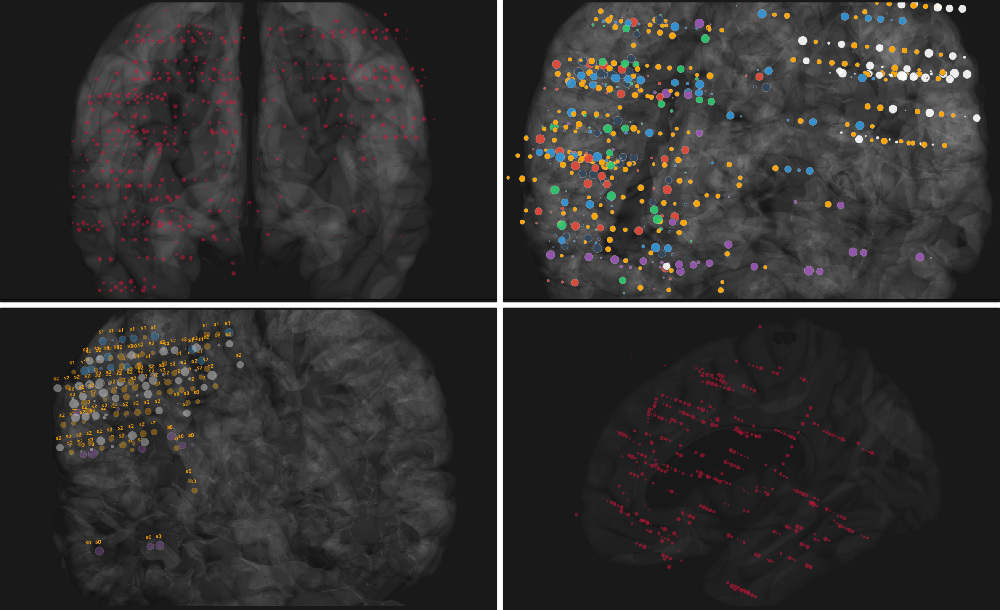
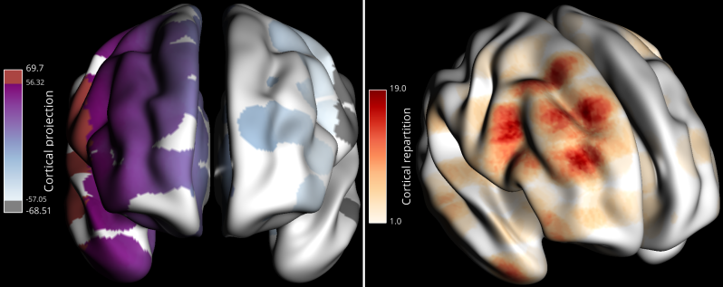
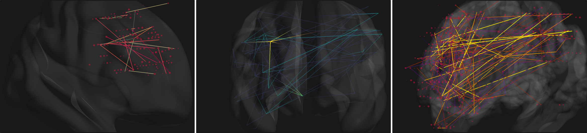
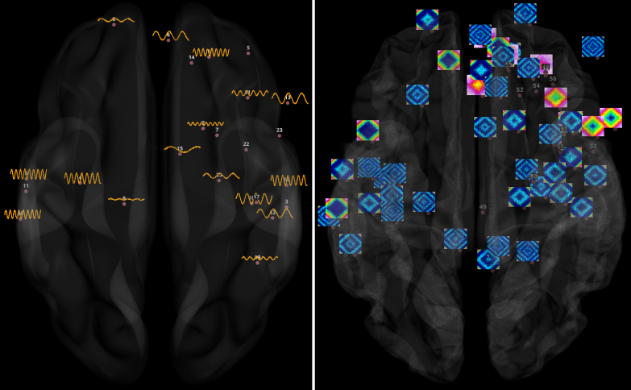
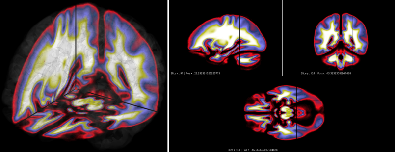
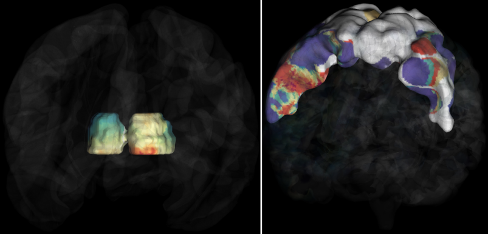
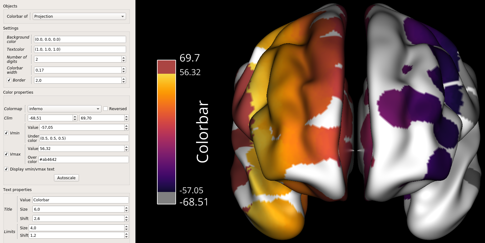

.. _BrainModule:

Brain
=====

.. admonition:: Overview
   :class: sd-bg-light

   Brain is a flexible graphical user interface for 3D visualisations on an
   MNI template.  It renders sources, connectivity graphs, ROIs and auxiliary
   overlays in a single canvas so exploratory analysis and publication-grade
   screenshots share the same workflow.  Explore the public API via
   :class:`visbrain.gui.Brain` or run curated demos with
   ``python -m visbrain.examples run brain/<example>``.

   The Brain GUI assembles multiple object types in a single scene.

Checkout the API of the :class:`visbrain.gui.Brain` class. If you need help with
the *Brain* module, ask your questions in the dedicated `gitter Brain chat
<https://gitter.im/visbrain-python/Brain?utm_source=share-link&utm_medium=link&utm_campaign=share-link>`_.

.. contents:: Contents
   :local:
   :depth: 2

.. ##########################################################################
..                                 DESCRIPTION
.. ##########################################################################

Main features
~~~~~~~~~~~~~

.. grid:: 1 1 2 2
   :gutter: 2

   .. card:: Graphical user interface
      :class-card: sd-bg-primary sd-text-white

      * Modular and responsive Qt layout.
      * Capture screenshots with configurable DPI.
      * Persist GUI state (buttons, sliders, checkboxes, camera angles).

   .. card:: Brain templates
      :class-card: sd-bg-light

      * Rotate, translate and zoom canonical MNI surfaces.
      * Control shading, transparency and hemisphere visibility.
      * Import custom templates alongside bundled assets.

   .. card:: Sources and connectivity
      :class-card: sd-bg-light

      * Visualise EEG, MEG and intracranial sources.
      * Render connectivity edges with per-link colour/width controls.
      * Project activity onto cortical surfaces for quick inspections.

   .. card:: Regions of interest
      :class-card: sd-bg-light

      * Display ROIs within a translucent anatomical context.
      * Leverage bundled atlases or import custom label maps.
      * Quantify source contributions per ROI.

   .. card:: Cross-sections and volumes
      :class-card: sd-bg-light

      * Slice volumetric data interactively.
      * Localise sources on orthogonal planes.
      * Load NIfTI stacks and apply consistent transfer functions.

   .. card:: Additional layers
      :class-card: sd-bg-light

      * Display time-series, static images and vector fields.
      * Compose publication-ready layouts with the colour-bar canvas.

Import and use Brain
~~~~~~~~~~~~~~~~~~~~

The *Brain* module can be imported as follow :

.. code-block:: python

    from visbrain.gui import Brain

GUI description
~~~~~~~~~~~~~~~

Components
^^^^^^^^^^

The *Brain* graphical user interface is subdivided into three main parts :

* **Menu** (*Save/load GUI config, take a screenshot*...)
* **Settings panel** (*display by default*)
* **Main canvas** where the brain is displayed
* **Colorbar canvas** (*hide by default*)
* **Cross-sections canvas** (*hide by default*)

Settings panel tabs
^^^^^^^^^^^^^^^^^^^

* Settings tab (*background color, object opacity and slice, light*)
* Brain tab (*brain template, ROI, cross-sections, volume*)
* Sources tab (*source's properties, text, cortical projection and repartition, time-series, pictures*)
* Connect tab (*connectivity settings*)
* Cbar tab (*colorbar properties of the selected object*)

Themes and accessibility
~~~~~~~~~~~~~~~~~~~~~~~~

The :menuselection:`Display --> Theme` submenu exposes the built-in
``Dark`` and ``Light`` palettes.  Switching themes updates the global Qt
palette so menus, dialogs and canvases immediately pick up the new colors.
Visbrain remembers the last selection, allowing contributors to document a
consistent look-and-feel across sessions or revert to high-contrast defaults
before screen captures.

.. note::
   Refresh theme previews locally with the Task 8 screenshot harness described
   in :doc:`modernization/phase-3`.  The capture script stores PNG assets under
   ``docs/_static/brain/`` for reference while drafting documentation, but the
   generated files are not committed to the repository.

Keyboard navigation and accessibility hints
~~~~~~~~~~~~~~~~~~~~~~~~~~~~~~~~~~~~~~~~~~~

All primary canvases request ``StrongFocus`` so keyboard users can reach them
with :kbd:`Tab`/:kbd:`Shift` + :kbd:`Tab`.  Global shortcuts such as
:kbd:`Ctrl+D` (toggle quick settings), :kbd:`Ctrl+N` (screenshot) and
:kbd:`Ctrl+E` (open the documentation) remain active even when a VisPy canvas is
focused thanks to the action rebinding performed during initialization.  The
:menuselection:`Help --> Shortcuts` entry—or the :kbd:`Ctrl+T` accelerator—opens
an accessible table describing the available key sequences and their effects.

.. note::
   Capture the shortcuts helper overlay through the same Task 8 harness when
   preparing release notes or tutorials so the keyboard table stays in sync with
   the shipped GUI.  Like the theme previews, keep the exported PNGs out of the
   tracked sources.

.. _brainshortcuts:

Shortcuts
^^^^^^^^^

==============          ==============================================
Keys                    Description
==============          ==============================================
<space>                 Brain transparency
<delete>                Reset camera
0                       Top view
1                       Bottom view
2                       Left view
3                       Right view
4                       Front view
5                       Back view
b                       Display / hide the brain
x                       Display / hide cross-sections
v                       Display / hide volume
s                       Display / hide sources
t                       Display / hide connectivity
r                       Display / hide Region Of Interest (ROI)
c                       Display / hide colorbar
a                       Auto-scale colormap
"+"                     Increase brain opacity
"-"                     Decrease brain opacity
CTRL + p                Run the cortical projection
CTRL + r                Run the cortical repartition
CTRL + d                Display / hide quick settings panel
CTRL + n                Screenshot window
CTRL + w                Screenshot of the entire window
CTRL + t                Show the shortcuts panel
CTRL + q                Exit
==============          ==============================================

.. ##########################################################################
..                                 TUTORIAL
.. ##########################################################################

MNI templates
~~~~~~~~~~~~~

By default, *Brain* ships with three bundled brain templates (B1 with cerebellum
coverage, and the smoother B2/B3 variants). They are packaged inside the wheel
and available through :func:`visbrain.io.path_to_visbrain_data` even in offline
environments.

High-resolution meshes such as the inflated or white surfaces remain optional.
Fetch them explicitly with::

   python -m visbrain.io.download inflated.npz --type templates

Use ``--list`` to explore the available template assets. Downloads are stored in
the Visbrain cache or the directory specified via ``--dest``.

Sources
~~~~~~~

Sources can be added to the scene using (x, y, z) MNI coordinates and comes with a relatively large number of properties (radius, color, shape...). Source's array of coordinates must be have a shape of (N, 3) with **N** the number of sources. In addition, several objects can be attached to sources :

* **Text :** add a text to each source.
* **Source's data :** must be (N,) vector of data (for instance beta power, entropy, amplitude...). The radius of each source is then proportional to the data attached to it. This activity can be projected onto the brain surface using the cortical projection.
* **Connectivity :** must be a (N, N) upper triangular array describing how to connect sources
* **Time-series and/or pictures** : finally, it's also possible to visualize signals (such as time-series, spectral signals...) and 2-D pictures (time-frequency maps, comodulogram...)

Cortical projection and repartition
^^^^^^^^^^^^^^^^^^^^^^^^^^^^^^^^^^^

   Cortical projection of source's activity (Left) and source's repartition (Right).

* **Cortical projection :** correspond to the projection of source's activity onto the brain (or ROI) surface.
* **Cortical repartition :** correspond to the number of sources contributing to each vertex of the surface. This is particularly convenient to inspect how sources are distributed on the surface.

Both methods use a **radius** parameter and only vertices with an euclidian distance under **radius** are going to be considered. From the GUI, those functions can be executed from the menu *Project*, from the tab *Sources/Properties/Projection*, using keyboard :ref:`brainshortcuts` or *Brain* methods.

Connect sources
^^^^^^^^^^^^^^^

   Example of connectivity.

Sources can be connected together using connectivity links. *Brain* provides three ways of coloring those links :

* **Strength :** color each link according to the connectivity strength
* **Count :** color each connectivity node according to the number of connections to it
* **Density :** color each link according to the number of existing links in a controllable sphere.

Attach time-series and/or pictures
^^^^^^^^^^^^^^^^^^^^^^^^^^^^^^^^^^

   Attach time-series (Left) and pictures (Right) to sources.

As a complement, *Brain* provides the ability to visualize directly into the MNI brain time-series and pictures.

.. warning::

   In the current 0.3.0 visbrain version, time-series and pictures don't rotate with the brain. As a consequence those elements can only be visualized in axial view. This should be solved in next release.

Volume
~~~~~~

Brain templates are surfaces defined by vertices and faces. In contrast, volumes are defined with a 3-D array (Nx, Ny, Nz). There is three scenarios where volumes can be used in *Brain*:

* **Cross-sections :** inspect volumes using slices
* **Region Of Interest (ROI) :** display deep brain regions
* **3-D volume rendering :** use VisPy.visuals.Volume rendering methods (mip, translucent, additive and iso)

Those volumes can be used to visualize nifti, dycom or any image files. By default, *Brain* comes with two volume files : **Brodmann areas** and **Anatomical Automatic Labeling (AAL)**.

Cross-sections
^^^^^^^^^^^^^^

   Cross-sections of a Nifti volume

Cross-sections correspond to an axial, sagittal and coronal slice of the volume and can either be visualize in 3-D (inside the brain template) or in slitted view

Region Of Interest (ROI)
^^^^^^^^^^^^^^^^^^^^^^^^

   Cortical projection on the thalamus (Left) and cortical repartition on Brodmann area 4 and 6.

If a volume is provided with corresponding labels, ROIs can be extracted and then be transformed into a mesh, compatible with source's projection methods.

Colorbar control
~~~~~~~~~~~~~~~~

   Colorbar example.

The colorbar can be controlled for individual objects including :

* **Connectivity** (*if defined*)
* **Pictures** (*if defined*)
* **Projections** (*if defined*)

Examples
~~~~~~~~

.. include:: generated/visbrain.gui.Brain.examples.rst