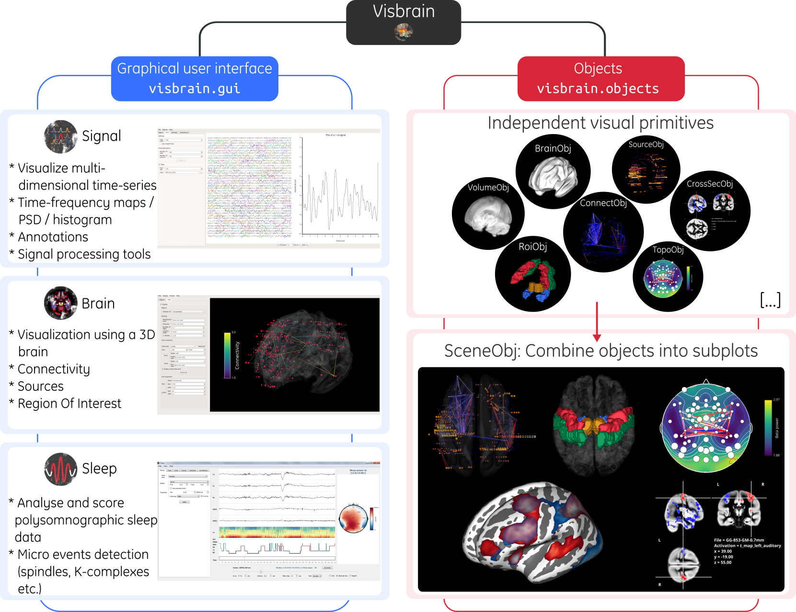

.. _Introduction:

Presentation
============

Quick description
-----------------

Visbrain is an open-source `Python 3 <https://www.python.org/>`_ package, distributed under the 3-Clause BSD license and is dedicated to brain signals visualization. It is under heavy development and many functionalities are frequently added to the package, such as bug fixing, documentation improvements etc.

Visbrain use VisPy to render graphics. Taken from their website :

.. raw:: html

    <blockquote class="blockquote">
      
VisPy is a high-performance interactive 2D/3D data visualization library leveraging the computational power of modern Graphics Processing Units (GPUs) through the OpenGL library to display very large datasets.

      <footer class="blockquote-footer">VisPy website : <a href="http://vispy.org">http://vispy.org</a></footer>
    </blockquote>

Structure
---------

Visbrain is mainly divided into two branches :

* **Modules** : modules comes with a graphical user interface (GUI) for interactions between plotted elements and parameters.
* **Objects** : objects are elementary bricks i.e. one visualization purpose per object. It's mainly designed for advanced users since objects are much more modular. See the :ref:`Objects` documentation and the API :class:`visbrain.objects`

======================  =======================================================
Module name             Description
======================  =======================================================
:ref:`BrainModule`      Visualizations involving a MNI brain
:ref:`SleepModule`      Visualize and score polysomnographic data
:ref:`SignalModule`     Visualize multi-dimensional datasets
:ref:`FigureModule`     Figure layout
======================  =======================================================

The visbrain structure is summarized below.

   Structure and hierarchy used in visbrain

Installation options
====================

Dependencies
------------

* NumPy (>= 1.26.4) and SciPy (>= 1.11.4)
* Matplotlib (>= 3.8.4)
* VisPy (>= 0.13.0)
* PySide6 (>= 6.7.1) — preferred Qt binding that bundles ``shiboken6``
* PyOpenGL (>= 3.1.7)
* Pillow (>= 10.3.0)

Optional dependencies
---------------------

* Pandas (>= 2.2.2) & xlrd (>= 2.0.1) : table import / export
* Pillow (>= 10.3.0) : export figures
* Nibabel (>= 5.2.1) : read nifti files
* MNE-python (>= 1.6.1) : alternative to read sleep data files
* Tensorpac (>= 0.6.5) : compute and display phase-amplitude coupling
* lspopt : multitaper spectrogram
* imageio (>= 2.34.1) : for animated GIF export

Data resources
--------------

Visbrain bundles a lightweight sample dataset inside the wheel so core
functionality works without touching the network. These resources include the
default brain templates, ROI atlases, a reference EEG montage and a short sleep
hypnogram. They can be accessed with :func:`visbrain.io.path_to_visbrain_data`
without creating ``~/visbrain_data``::

   from visbrain.io import path_to_visbrain_data

   bundled = path_to_visbrain_data('B1.npz', folder='templates')

Additional examples—such as the extended sleep recordings or large surface
meshes—remain optional downloads. Use the command line helper to fetch them into
Visbrain's writable cache::

   python -m visbrain.io.download sleep_rec.zip --type example_data

The cache lives in a platform-appropriate directory (``%APPDATA%/Visbrain`` on
Windows, ``~/Library/Application Support/Visbrain`` on macOS and
``~/.local/share/visbrain`` on Linux) and is orchestrated by
:class:`visbrain.io.cache.CacheManager`. Durable downloads land in the ``data``
category while scratch files use ``tmp`` so tests and demos can clean up after
themselves with ``cache_manager.cleanup_owner``. Set ``VISBRAIN_DATA_DIR`` to
store the datasets in a custom location. The downloader accepts ``--list`` to
show all available assets and honours ``--dest`` or ``--use-pwd`` when you
prefer to download into a project-specific directory.

Local data helpers
------------------

Several convenience readers in :mod:`visbrain.io.read_data` simplify loading
local files that complement the bundled resources. They wrap standard library
parsers and therefore return familiar Python objects:

* :func:`~visbrain.io.read_data.read_txt` returns the file contents as a
  single string.
* :func:`~visbrain.io.read_data.read_csv` yields the CSV rows as a list of
  string lists, preserving the column order.
* :func:`~visbrain.io.read_data.read_json` decodes JSON into Python
  dictionaries, lists and primitives.
* :func:`~visbrain.io.read_data.read_pickle` restores the original pickled
  object (or specific keys when the pickle stores a mapping).
* :func:`~visbrain.io.read_data.read_npz` exposes NumPy arrays from
  compressed archives, returning a dictionary by default or a single array when
  ``vars`` selects one name.

These helpers integrate naturally with ``path_to_visbrain_data``; simply build
the path and pass it to the appropriate reader.

Regular installation
--------------------

In order to install Visbrain, or to update it, run the following command in a terminal :

.. code-block:: shell

    pip install -U visbrain

Develop mode
------------

If you want to install visbrain in develop mode :

.. code-block:: shell

    git clone https://github.com/EtienneCmb/visbrain.git visbrain/
    cd visbrain/
    python -m pip install -e .

From here you can switch to the latest features using :

.. code-block:: shell

    git checkout develop

If you don't want to clone the full package, run :

.. code-block:: shell

    pip install git+https://github.com/EtienneCmb/visbrain.git

Update visbrain
---------------
You can update visbrain using :

.. code-block:: shell

    pip install --upgrade visbrain