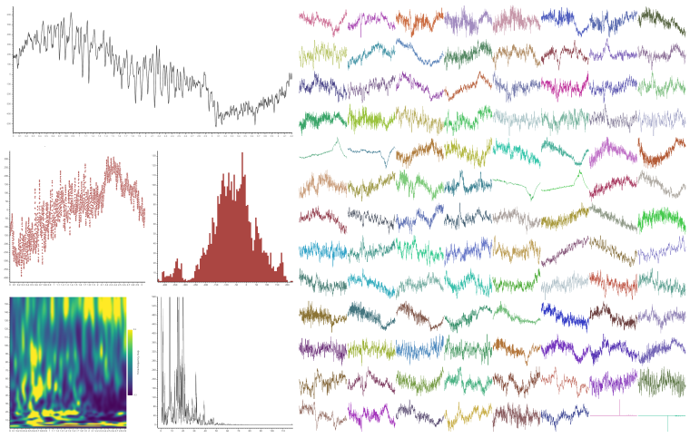

.. _SignalModule:

.. currentmodule:: visbrain.gui

Signal
######

.. admonition:: Overview
   :class: sd-bg-light

   Signal is a data-mining module for one-, two- and three-dimensional
   recordings.  It exposes grid and single-trace layouts for rapid inspection,
   couples them with spectral analyses and supports annotation workflows.  Use
   :class:`~visbrain.gui.Signal` from Python or run curated demos with
   ``python -m visbrain.examples run signal/<example>``.

Checkout the API of the :class:`~visbrain.gui.Signal` class.

.. contents:: Contents
   :local:
   :depth: 2

GUI Description
~~~~~~~~~~~~~~~

The GUI of the Signal module is subdivided into to two distinct components :

* **The grid** : each datasets is re-arranged into a clickable 2-D grid so that all of the time-series of a dataset are represented inside. This idea of a grid was originally present into the `VisPy examples <https://github.com/vispy/vispy/blob/master/examples/demo/gloo/realtime_signals.py>`_ and has been adapted for brain signals.
* **The signal canvas** : the second layout display one trial at a time. This trial can either be represented as a continuous line or markers. It's also possible to compute the histogram, time-frequency map or PSD.

Main features
~~~~~~~~~~~~~

.. grid:: 1 1 2 2
   :gutter: 2

   .. card:: Grid disposition
      :class-card: sd-bg-primary sd-text-white

      * Map 2-D and 3-D datasets onto interactive grids.
      * Zoom, pan and double-click to focus on individual traces.

   .. card:: Signal inspection
      :class-card: sd-bg-light

      * Navigate through channels with keyboard shortcuts.
      * Switch between line, marker, histogram, spectrogram and PSD views.
      * Import and export annotations for collaborative scoring.

   .. card:: Processing toolbox
      :class-card: sd-bg-light

      * Detrend and demean signals on demand.
      * Apply low-pass, high-pass, band-pass or band-stop filters.
      * Compute amplitude, phase and power across frequency bands.
      * Capture screenshots of the full GUI, the grid or the single-signal
        canvas.

Import and use Signal
~~~~~~~~~~~~~~~~~~~~~

The :class:`~visbrain.gui.Signal` module can be imported as follow :

.. code-block:: python

    from visbrain.gui import Signal

Shortcuts
~~~~~~~~~

* go = Grid canvas only
* so = Signal canvas only

======================  =======================================================
Keys                    Description
======================  =======================================================
Double click (go)       Enlarge signal under the mouse cursor
n (so)                  Go to the next signal
b (so)                  Go to the previous signal
Double click (so)       Insert annotation
g                       Display / hide grid
s                       Display / hide signal
<delete> (go and so)    Reset the camera
CTRL + t                Display shortcuts
CTRL + d                Display / hide setting panel
CTRL + n                Take a screenshot
CTRL + q                Close Sleep graphical interface
======================  =======================================================

Examples
~~~~~~~~

.. include:: generated/visbrain.gui.Signal.examples.rst